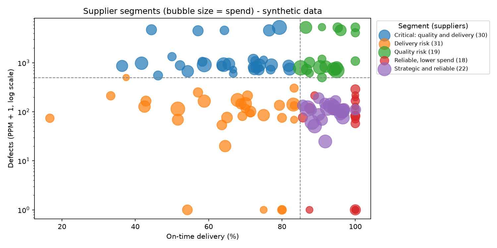
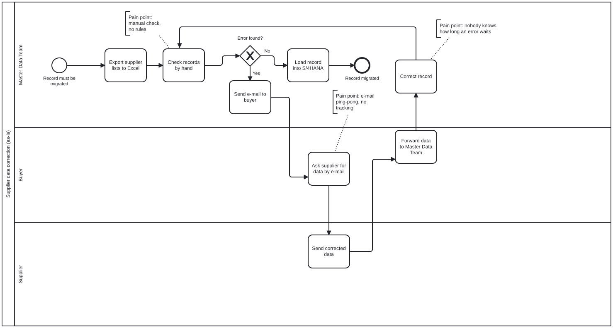
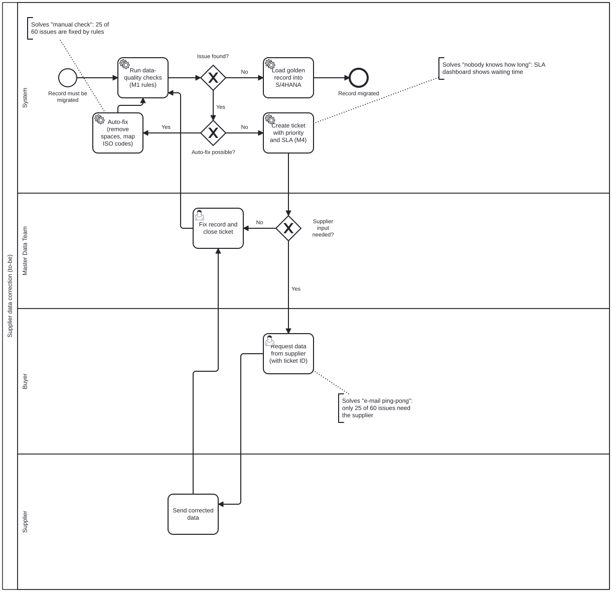
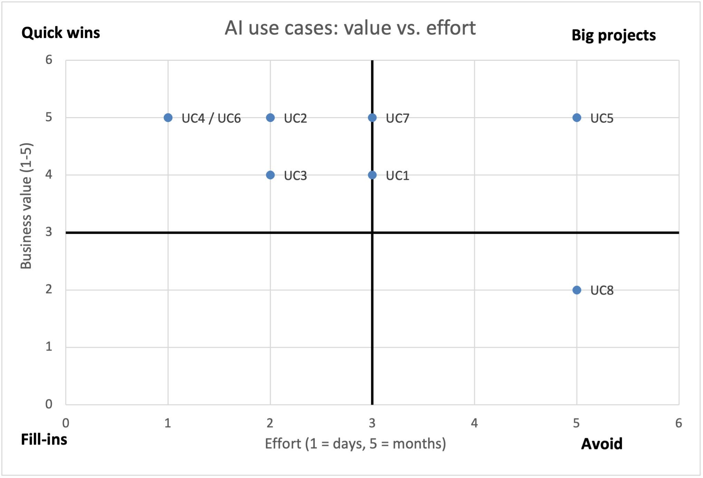

# Supplier Data Health Check for an SAP S/4HANA Migration

A portfolio project that simulates a common migration problem: two ERP systems (one SAP-like, one non-SAP) hold overlapping supplier master data that must be cleaned and merged into one SAP S/4HANA system. The project follows the data from the quality check to supplier KPIs, a ticket process, AI use cases and the mapping to SAP.

**Status (October 2026):** M1 to M5, the process analysis and M7 (SAP mapping) are done; M6 (spend analysis) is in progress.

## At a glance

| | Result |
|---|---|
| Data quality (M1) | 164 supplier records from two ERPs checked, 60 issues found, merged into 120 golden records |
| Supplier KPIs (M2) | On-time delivery, PPM and spend for 120 suppliers in 5 segments; 30 suppliers are critical in both quality and delivery |
| AI test (M3) | AI vs. my own labels on 30 quality complaints; a human-review rule caught all 6 ambiguous cases |
| Ticket tracker (M4, Excel) | 60 issues as tickets with priority and SLA; dashboard of open and overdue tickets |
| Process (BPMN 2.0) | As-is vs. to-be: rules fix 25 of 60 issues, manual tasks in the model drop from 7 to 3 |
| AI use cases (M5, Excel) | 8 AI ideas scored on value, data readiness, effort and risk |
| Spend (M6, Excel) | ABC analysis: 60 A, 34 B and 26 C suppliers |
| SAP mapping (M7, Excel) | 18 legacy fields mapped to the S/4HANA business partner (LFA1, LFBK, LFB1) with transformation rules; 8 project steps mapped to SAP apps and transactions |

## Please note

- **All data is synthetic.** It is generated by `src/generate_data.py`. No real company, supplier or person data is used, and the project is not affiliated with any company.
- **AI-assisted development.** The Python code was written with an AI coding assistant (Claude Code). I directed the work, reviewed the results and am learning each step.
- **Built by me in Excel:** the ticket tracker (M4), the AI use-case scoring (M5), the spend analysis (M6) and the SAP mapping (M7). The BPMN models are drawn by me. The commit history shows each step.

## Modules

| Module | What it does | Status |
|---|---|---|
| M1 Data quality | Finds missing, inconsistent, invalid and duplicate supplier records; merges both ERPs into golden records | Done |
| M2 Supplier analysis | Supplier KPIs (on-time delivery, PPM, spend) and transparent KPI-based segments | Done |
| M3 Trustworthy AI | AI classifies quality complaints; results are measured against my own labels and a human-review rule | Done (first test) |
| M4 Ticket tracker (Excel) | Data-quality issues as tickets with formulas, KPIs and a dashboard | Done |
| Process analysis (BPMN) | As-is vs. to-be model of the supplier data correction process | Done |
| M5 AI use-case prioritization (Excel) | 8 AI ideas for the migration scored and ranked; value-vs-effort matrix | Done |
| M6 Spend analysis (Excel) | Spend shares, ABC classes, payment terms | In progress (ABC done) |
| M7 SAP S/4HANA mapping (Excel) | Legacy fields and project steps mapped to S/4HANA objects, tables and rules | Done (conceptual) |

## M1: Data quality and golden records

ERP A (89 records, SAP-style field names such as `LIFNR`, `NAME1`, `STCEG`) and ERP B (75 records, English field names) are checked with rules for four data-quality dimensions:

| Dimension | ERP A | ERP B | Total | Example |
|---|---|---|---|---|
| Completeness | 15 | 8 | 23 | Missing VAT ID, IBAN or payment terms |
| Consistency | 0 | 25 | 25 | VAT ID with spaces, country names instead of ISO codes |
| Uniqueness | 4 | 0 | 4 | Two records with the same VAT ID |
| Validity | 6 | 2 | 8 | Wrong VAT format, IBAN check digit fails |

Matching records from both systems are merged into 120 golden records (`data/output/golden_suppliers.csv`); every issue has a suggested action (`data/output/dq_issues.csv`).

## M2: Supplier KPIs and segments

From 3,284 purchase order lines and 367 quality notifications, each golden supplier gets on-time delivery (OTD), PPM (rejected parts per million) and spend. Suppliers are grouped into segments with clear KPI targets:

| Segment | Suppliers | Spend share | Median OTD | Median PPM |
|---|---|---|---|---|
| Strategic and reliable | 22 | 31.0% | 92.9% | 109 |
| Critical: quality and delivery | 30 | 25.8% | 66.7% | 898 |
| Delivery risk | 31 | 20.6% | 69.2% | 114 |
| Quality risk | 19 | 17.4% | 91.9% | 835 |
| Reliable, lower spend | 18 | 5.3% | 100.0% | 96 |



## M4: Excel ticket tracker (built by me)

`excel/BU2_Ticket_Tracker.xlsx` turns the 60 data-quality issues from M1 into tickets.
Created dates, status and owners are simulated.

- **Tickets sheet:** Excel Table `tblTickets`, frozen header, filters, dropdown lists (data validation) for Status and Priority
- **Formulas:** `XLOOKUP` (supplier segment from the M2 scorecard, SLA days per priority), `IF` + `TODAY` (ticket age), `IF` (SLA breached or OK)
- **Dashboard sheet:** KPIs with `COUNTA`, `COUNTIF` and `COUNTIFS`; conditional formatting; PivotTable by supplier segment and SLA status with a Status slicer
- **Example result (5 Oct 2026):** 39 of 60 tickets are open and 29 of them are past their SLA. The formula KPIs and the PivotTable give the same numbers.

## Process analysis: as-is vs. to-be (BPMN 2.0, drawn by me)

I modelled how supplier data errors are corrected today (as-is) and how the process works with the rules from M1 and the ticket tracker from M4 (to-be). Both models are in `docs/` as `.bpmn` (open them at bpmn.io) and `.svg`.

| | As-is | To-be |
|---|---|---|
| Checks | By hand in Excel | Rules (M1) run automatically |
| Issues that go to the supplier | All of them, by e-mail | 25 of 60 (the other 25 are fixed by rules, 10 internally) |
| Hand-offs between teams for a supplier issue | 4 (via the buyer both ways) | 3 (supplier answers directly with the ticket ID) |
| Tracking | None | Ticket with priority and SLA, dashboard (M4) |
| Manual tasks in the model | 7 | 3 |

The split of the 60 issues comes from the `suggested_action` column of M1's issue list. Times are not measured, because the data is synthetic.

**As-is**



**To-be**



## M5: Which AI idea first? (built by me)

`excel/AI_Use_Case_Prioritization.xlsx` lists 8 AI use cases for the migration (from duplicate detection to an agent that changes master data by itself).

- **I scored** each one from 1 to 5 on business value, data readiness, effort and risk, using the written guide in the `Scoring Guide` sheet.
- **Weighted score:** value 40%, data readiness 20%, effort 20% and risk 20%. Effort and risk count against an idea, so they are inverted with `6 - score`. Ranked with `RANK.EQ`.
- **Result:** complaint classification (already piloted in M3) ranks first. The auto-correcting master-data agent ranks last because it would change data without a human check. I raised the risk of the AI supplier summary because language models can invent numbers.
- The scores are my own judgement for a simulated company, not measured values.



## M6: Spend analysis (built by me)

`excel/Spend_Analysis.xlsx` starts with one row per golden supplier (spend, commodity, segment, KPIs, payment term). The calculations are built by hand:

- **Spend share and cumulative share** with an expanding `SUM` range, sorted by spend
- **ABC classes** with a nested `IF` (A up to 80% of spend, B up to 95%, C the rest) and a `COUNTIF` summary: **60 A, 34 B, 26 C** (check total 120)
- **Spend at risk:** a PivotTable by supplier segment shows that **64% of spend (€186m)** goes to suppliers that miss at least one KPI target; only 31% goes to strategic and reliable suppliers
- **Payment terms:** `XLOOKUP` of net days per payment term, then:
  - cash effect if every supplier moved to a 60-day standard term: **€18.0m** more cash on average (spend per day × extra days)
  - cash discount potential if all "2% 14 days" discounts were taken: **€1.15m**
  - **4 suppliers (€12.7m spend) have no payment terms**, the same gap M1 flagged as a data-quality issue
- **Trade-off:** for the "2% 14 days" suppliers, the two levers exclude each other (pay early for the discount, or pay late for cash), so the choice has to be made per supplier
- Spend covers 5 Jan – 16 Sep 2026 (255 days) of synthetic purchase-order data; the 60-day target is an assumption

## M7: Mapping to SAP S/4HANA (built by me)

`excel/SAP_S4HANA_Mapping.xlsx` answers four questions for every legacy field: which S/4HANA object, which table and field, which business partner role, and which transformation rule (taken from the M1 issue list).

| Legacy field | S/4HANA target | BP role | Transformation rule |
|---|---|---|---|
| `LIFNR` / `supplier_code` | Business partner, `LFA1-LIFNR` | General data | New BP number; keep the old number as reference |
| `country` (ERP B) | `LFA1-LAND1` | General data | Map country names to ISO codes (Germany to DE) |
| `STCEG` / `vat_number` | `LFA1-STCEG` | General data | Remove spaces; request missing values; verify the format (EU VIES) |
| `IBAN` | Bank details (`LFBK`) | General data | Block payments if the check digit fails |
| `ZTERM` / `payment_terms` | `LFB1-ZTERM` | FLVN00 (financial accounting) | Map text such as "2% 14 days, net 30" to a payment terms key |
| `main_commodity` | Material group on the PO item (`EKPO-MATKL`) | Not BP data | Map commodity text to a material group key |

The `SAP_Glossary` sheet explains the SAP terms used. The `Process_Mapping` sheet shows where each project step would happen in S/4HANA:

| Project step | SAP S/4HANA | Object / table |
|---|---|---|
| Data-quality rules and duplicate check (M1) | SAP MDG | Business partner |
| Load the 120 golden records | Migration Cockpit ("Migrate Your Data") | Migration object "Supplier" |
| Purchase orders with promised date (M2) | ME21N / ME23N | EKKO, EKPO, EKET-EINDT |
| Goods receipt: delivery date and quantity (M2) | MIGO, movement type 101 | MATDOC |
| Rejected parts for PPM (M2) | MIGO return delivery (122) or QM inspection lot | MATDOC / QALS |
| Quality complaints (M3) | QM01 / QM02 / QM03, notification type Q2 | QMEL |
| Ticket tracking (M4) | No standard S/4HANA tool: MDG change request or a ticket tool | n/a |

**This is a conceptual mapping based on SAP documentation and my ERP course; no live SAP system was used.**

## M3: Can we trust an AI to sort quality complaints?

1. 30 complaints were sampled (6 per category, 6 of them ambiguous). Texts include typos and German terms.
2. **I labelled them by hand** first, using a written labelling guide.
3. A **separate Claude session** that had seen neither the answer key nor my labels classified them with the prompt in `prompts/m3_classify_prompt.md`.
4. `src/m3_evaluate.py` compares both with the synthetic answer key and tests a review rule.

| | Correct (of 30) |
|---|---|
| AI | 30 |
| My labels | 21 (mistakes came from unfamiliar technical terms, e.g. salt spray test, 8D, VDA label) |

**Review rule:** the AI may decide alone only when its confidence is "high" and it sees no second category. On this test the rule sent 7 complaints to a human, including all 6 ambiguous ones; the 23 auto-assigned complaints were all correct.

**Limits:** the texts are short and synthetic, and the categories were defined by the same person who wrote them, so 30/30 is optimistic. Real complaints would need a new test before any use.

## Run

```bash
python -m venv .venv
.venv/bin/pip install -r requirements.txt
.venv/bin/python src/generate_data.py
.venv/bin/python src/m1_data_quality.py
.venv/bin/python src/m2_supplier_analysis.py
.venv/bin/python src/m4_export_tickets.py
.venv/bin/python src/m4_export_supplier_lookup.py
.venv/bin/python src/m3_make_labeling_sheet.py
.venv/bin/python src/m3_evaluate.py
.venv/bin/python src/m5_ai_use_cases_template.py
.venv/bin/python src/m6_export_spend_workbook.py
.venv/bin/python src/m7_export_sap_mapping_template.py
```

The `export` and `template` scripts write starting workbooks with the data only (for example `excel/BU2_Ticket_Tracker_start.xlsx`); the finished workbooks were built from them by hand in Excel. The template scripts refuse to overwrite an existing workbook.
